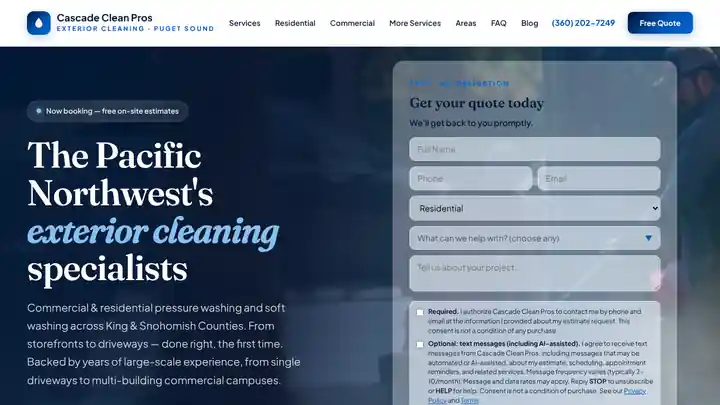

# Cascade Clean Pros website

Live site: **[cascadecleanpros.com](https://cascadecleanpros.com)**



Marketing website for Cascade Clean Pros, an owner-operated pressure washing and soft washing company serving King and Snohomish Counties, Washington. Versioned on GitHub and deployed on Cloudflare Pages.

## What's on the site

- **Service pages:** house washing, roof cleaning, driveway and concrete cleaning, gutter cleaning, commercial fleet washing and junk removal
- **Local SEO pages:** Everett, Kirkland, Lynnwood and Mill Creek
- **Blog:** articles on soft washing vs. pressure washing, roof moss, house-washing frequency and vinyl siding
- **Quote form** that posts to Google Apps Script, with SMS-consent language
- **Search basics:** sitemap.xml, robots.txt and an llms.txt file for AI search
- **Privacy and terms pages**

## How it's built

The site is **prerendered React**. The full page is baked into `index.html` so search engines and social previews see real content, and `app.js` hydrates it for interactivity (navigation, service tabs, FAQ, quote form). Build tooling lives in `build/` so the repo root stays purely static and Cloudflare Pages deploys it with no build step.

```
cd build
npm install      # first time only
npm run build    # writes ../index.html and ../app.js
```

See [BUILD.md](BUILD.md) for the full file map.

## About

Built and maintained by [Chris Ihler](https://github.com/ChrisIhler), co-owner of Cascade Clean Pros and an AI implementation and automation consultant. Available for website and automation work on [Upwork](https://www.upwork.com/freelancers/chrisihler).
